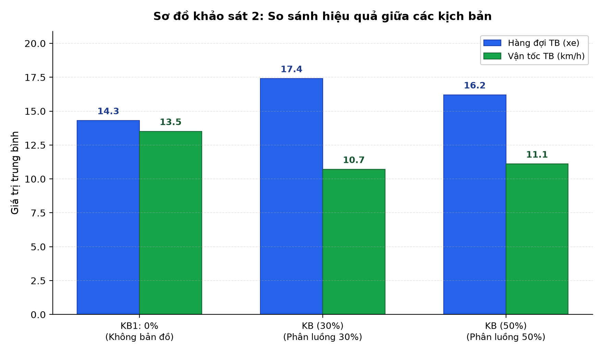

# BÁO CÁO KHẢO SÁT MÔ PHỎNG ITS — NGÃ TƯ HÀNG XANH (SUMO + TRACI)

- **Mạng lưới:** `hangxanh.net.xml` | **Luồng xe:** `hangxanh.rou.xml`
- **Edge khảo sát trục chính:** `E31` | **Bước tối đa:** `300`

## 1. Kết quả khảo sát từng kịch bản (ghi trực tiếp khi hoàn tất)

### Kịch bản: `baseline` — Kịch bản 1: Không phân luồng (0%)

- **Số bước chạy:** 300 | **Thời gian thực thi:** 63.85s | **Xe đổi lộ trình:** 0 | **Lượt chen/đổi làn:** 3086
- **Xe hoàn tất:** 769 | **TG đi TB:** 67.08s | **TG chờ TB:** 17.35s
- **Hàng đợi TB:** 14.3 xe | **Hàng đợi max:** 100 xe | **Vận tốc TB:** 13.5 km/h
- **Top edge hàng đợi lớn nhất:** `E43` (100 xe), `E14` (75 xe), `E32` (74 xe), `E11` (58 xe), `E31` (39 xe)

### Kịch bản: `reroute_30pct` — Kịch bản: Phân luồng bản đồ số (30%)

- **Số bước chạy:** 300 | **Thời gian thực thi:** 76.51s | **Xe đổi lộ trình:** 280 | **Lượt chen/đổi làn:** 8280
- **Xe hoàn tất:** 641 | **TG đi TB:** 69.75s | **TG chờ TB:** 19.19s
- **Hàng đợi TB:** 17.4 xe | **Hàng đợi max:** 99 xe | **Vận tốc TB:** 10.7 km/h
- **Top edge hàng đợi lớn nhất:** `E43` (99 xe), `E11` (91 xe), `E32` (88 xe), `E14` (75 xe), `E31` (51 xe)

### Kịch bản: `reroute_50pct` — Kịch bản: Phân luồng bản đồ số (50%)

- **Số bước chạy:** 300 | **Thời gian thực thi:** 76.28s | **Xe đổi lộ trình:** 477 | **Lượt chen/đổi làn:** 9517
- **Xe hoàn tất:** 657 | **TG đi TB:** 70.18s | **TG chờ TB:** 17.34s
- **Hàng đợi TB:** 16.2 xe | **Hàng đợi max:** 88 xe | **Vận tốc TB:** 11.1 km/h
- **Top edge hàng đợi lớn nhất:** `E43` (88 xe), `E14` (83 xe), `E32` (79 xe), `E11` (68 xe), `E31` (43 xe)

## 2. Bảng so sánh tổng hợp giữa các kịch bản

| Kịch bản | Bước | Chạy (s) | Xe hoàn tất | Đổi route | Chen làn | TG chờ TB (s) | Hàng đợi TB (xe) | Hàng đợi max (xe) | Vận tốc TB (km/h) |
|---|---:|---:|---:|---:|---:|---:|---:|---:|---:|
| `baseline` | 300 | 63.85 | 769 | 0 | 3086 | 17.35 | 14.3 | 100 | 13.5 |
| `reroute_30pct` | 300 | 76.51 | 641 | 280 | 8280 | 19.19 | 17.4 | 99 | 10.7 |
| `reroute_50pct` | 300 | 76.28 | 657 | 477 | 9517 | 17.34 | 16.2 | 88 | 11.1 |

## 3. Chạy demo SUMO và đóng xuất kết quả

- **Trạng thái:** Đã mở SUMO-GUI chạy 100 bước với tỷ lệ 50% và tự đóng để xuất kết quả
- **Số bước demo:** 100 | **Thời lượng demo:** 28.27s
- **Xe hoàn tất trong demo:** 217 | **Xe đổi lộ trình:** 144 | **Hàng đợi max:** 63 xe

## 4. Hai sơ đồ khảo sát kết quả

