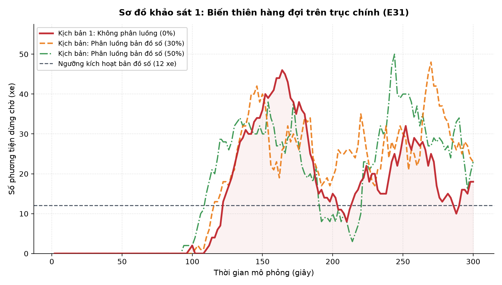

# BÁO CÁO KHẢO SÁT MÔ PHỎNG ITS — NGÃ TƯ HÀNG XANH (SUMO + TRACI)

- **Mạng lưới:** `hangxanh.net.xml` | **Luồng xe:** `hangxanh.rou.xml`
- **Edge khảo sát trục chính:** `E31` | **Bước tối đa:** `300`

## 1. Kết quả khảo sát từng kịch bản (ghi trực tiếp khi hoàn tất)

### Kịch bản: `baseline` — Kịch bản 1: Không phân luồng (0%)

- **Số bước chạy:** 300 | **Thời gian thực thi:** 38.62s | **Xe đổi lộ trình:** 0 | **Lượt chen/đổi làn:** 2839
- **Xe hoàn tất:** 799 | **TG đi TB:** 68.14s | **TG chờ TB:** 18.76s
- **Hàng đợi TB:** 14.2 xe | **Hàng đợi max:** 92 xe | **Vận tốc TB:** 14.1 km/h
- **Top edge hàng đợi lớn nhất:** `E43` (92 xe), `E32` (75 xe), `E14` (70 xe), `E11` (55 xe), `E31` (49 xe)

### Kịch bản: `reroute_30pct` — Kịch bản: Phân luồng bản đồ số (30%)

- **Số bước chạy:** 300 | **Thời gian thực thi:** 73.47s | **Xe đổi lộ trình:** 300 | **Lượt chen/đổi làn:** 6500
- **Xe hoàn tất:** 735 | **TG đi TB:** 73.41s | **TG chờ TB:** 17.63s
- **Hàng đợi TB:** 17.1 xe | **Hàng đợi max:** 84 xe | **Vận tốc TB:** 12.4 km/h
- **Top edge hàng đợi lớn nhất:** `E43` (84 xe), `E32` (76 xe), `E14` (75 xe), `E11` (66 xe), `E31` (48 xe)

### Kịch bản: `reroute_50pct` — Kịch bản: Phân luồng bản đồ số (50%)

- **Số bước chạy:** 300 | **Thời gian thực thi:** 59.98s | **Xe đổi lộ trình:** 502 | **Lượt chen/đổi làn:** 9014
- **Xe hoàn tất:** 696 | **TG đi TB:** 73.55s | **TG chờ TB:** 18.97s
- **Hàng đợi TB:** 16.6 xe | **Hàng đợi max:** 83 xe | **Vận tốc TB:** 11.9 km/h
- **Top edge hàng đợi lớn nhất:** `E43` (83 xe), `E32` (81 xe), `E11` (80 xe), `E14` (73 xe), `E31` (50 xe)

## 2. Bảng so sánh tổng hợp giữa các kịch bản

| Kịch bản | Bước | Chạy (s) | Xe hoàn tất | Đổi route | Chen làn | TG chờ TB (s) | Hàng đợi TB (xe) | Hàng đợi max (xe) | Vận tốc TB (km/h) |
|---|---:|---:|---:|---:|---:|---:|---:|---:|---:|
| `baseline` | 300 | 38.62 | 799 | 0 | 2839 | 18.76 | 14.2 | 92 | 14.1 |
| `reroute_30pct` | 300 | 73.47 | 735 | 300 | 6500 | 17.63 | 17.1 | 84 | 12.4 |
| `reroute_50pct` | 300 | 59.98 | 696 | 502 | 9014 | 18.97 | 16.6 | 83 | 11.9 |

## 3. Chạy demo SUMO và đóng xuất kết quả

- **Trạng thái:** Đã mở SUMO-GUI chạy 100 bước với tỷ lệ 50% và tự đóng để xuất kết quả
- **Số bước demo:** 100 | **Thời lượng demo:** 18.36s
- **Xe hoàn tất trong demo:** 206 | **Xe đổi lộ trình:** 144 | **Hàng đợi max:** 64 xe

## 4. Hai sơ đồ khảo sát kết quả

