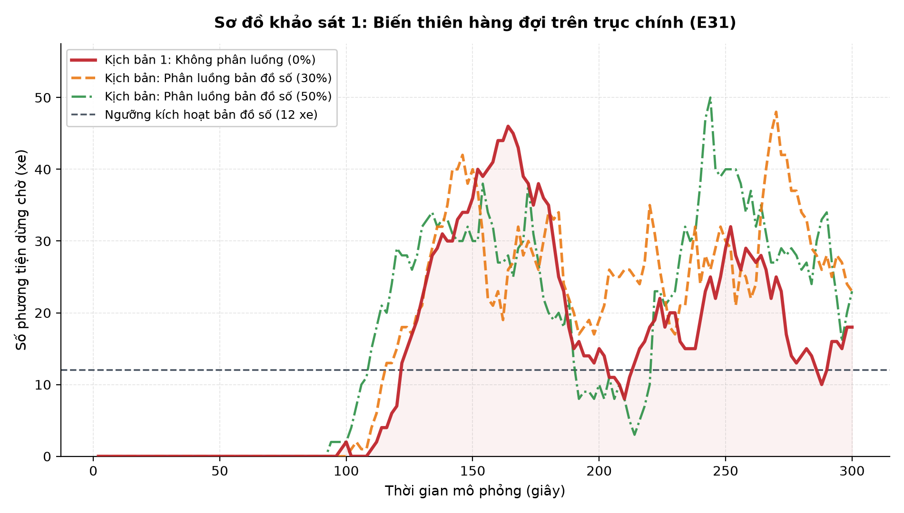
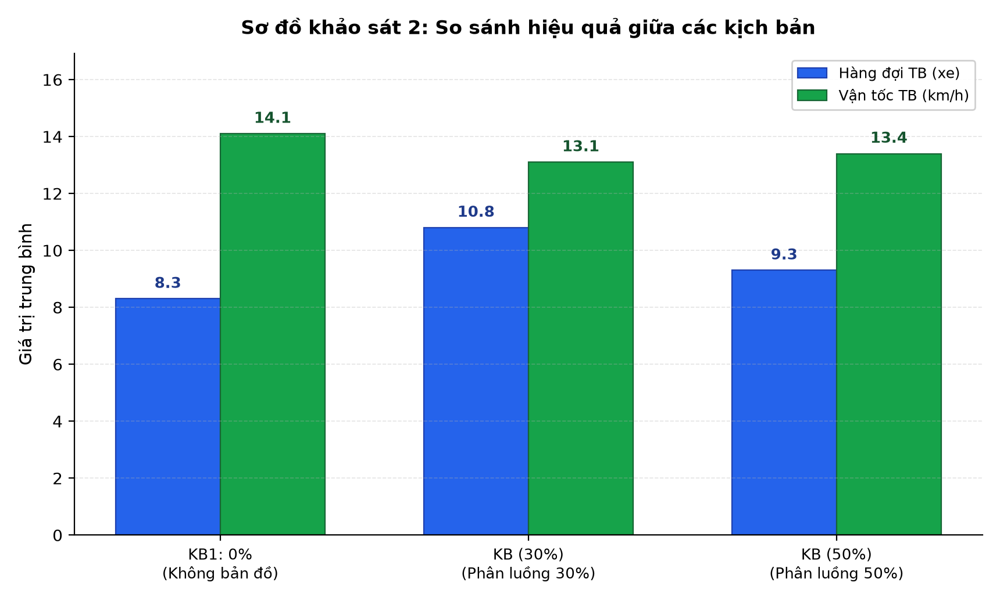

# Mô phỏng giao thông ITS và đánh giá phân luồng bản đồ số tại Ngã tư Hàng Xanh (SUMO + Python TraCI)

## 1. Giới thiệu bài toán
Ngã tư Hàng Xanh (TP.HCM) là điểm giao cắt có mật độ phương tiện cao và dễ phát sinh ùn ứ cục bộ. Dự án xây dựng mô hình mô phỏng giao thông bằng **SUMO (Simulation of Urban MObility)** kết nối **Python TraCI** để khảo sát:
- Hiệu quả phân luồng lộ trình theo bản đồ số ở các kịch bản `0%` (không phân luồng), `30%` và `50%`.
- Diễn biến hàng đợi trên trục khảo sát chính (`E31`) theo thời gian mô phỏng.
- Hành vi kiểm tra làn có xe/bị cản trở và chuyển/chen sang làn thoáng hơn (`try_lane_weave_if_blocked`).
- Tự động tổng hợp báo cáo (`.md`, `.json`) và xuất 2 biểu đồ so sánh trực quan (`.png`).

## 2. Yêu cầu môi trường & cài đặt
- **Eclipse SUMO** (đã cài đặt và cấu hình biến môi trường `SUMO_HOME` trỏ tới thư mục cài SUMO).
- **Python 3.x** cùng các thư viện phục vụ vẽ biểu đồ:
  ```powershell
  pip install matplotlib numpy
  ```

## 3. Hướng dẫn chạy mô phỏng (1 lệnh mở SUMO)
Mở terminal tại thư mục dự án và chạy lệnh dưới đây để mở **SUMO-GUI** chạy demo trực tiếp trước, sau đó tự động chạy tiếp các kịch bản nền và xuất báo cáo cùng biểu đồ:

```powershell
python simulate_hangxanh_v5.py --cfg hangxanh.sumocfg --net hangxanh.net.xml --rou hangxanh.rou.xml --focus-edge E31 --ratios 0.3 0.5 --max-steps 300 --sample-interval 2 --format both --charts --demo-sumo --demo-first --demo-steps 100
```

## 4. Cơ chế mô phỏng chính
- **Kịch bản đối chứng & phân luồng (`baseline`, `reroute_30pct`, `reroute_50pct`):** Cập nhật trọng số thời gian di chuyển theo tình trạng tốc độ/ùn tắc trên các `edge` và định tuyến lại một phần phương tiện theo tỷ lệ `reroute_ratio`.
- **Chuyển/chen làn khi làn có xe (`try_lane_weave_if_blocked`):** Khi phương tiện gặp xe phía trước ở cự ly gần, tốc độ thấp hoặc mật độ chiếm dụng cao trên làn hiện tại, hệ thống đánh giá làn lân cận (số lượng xe, độ chiếm dụng) và thực hiện chuyển làn khi điều kiện cho phép.
- **Đầu ra tự động:** Ghi nối tiếp kết quả từng kịch bản vào file Markdown, xuất file JSON dữ liệu chi tiết và tạo 2 sơ đồ khảo sát.

## 5. Cấu trúc thư mục và file chính
- `simulate_hangxanh_v5.py`: Mã nguồn chính điều khiển SUMO qua TraCI, tính chỉ số giao thông, xuất báo cáo và biểu đồ.
- `hangxanh.sumocfg`: File cấu hình tổng thể của mô phỏng SUMO.
- `hangxanh.net.xml` & `hangxanh.netecfg`: Dữ liệu mạng lưới đường và cấu hình mạng lưới khu vực khảo sát.
- `hangxanh.rou.xml`: Dữ liệu luồng phương tiện và lộ trình.
- `Ket_Qua_Mo_Phong_Hang_Xanh.md`: Báo cáo tổng hợp kết quả theo từng kịch bản và bảng so sánh.
- `Ket_Qua_Mo_Phong_Hang_Xanh.json`: Dữ liệu kết quả chi tiết phục vụ tra cứu hoặc xử lý thêm.
- `Ket_Qua_Mo_Phong_Hang_Xanh_so_do_1_bien_thien.png`: Sơ đồ biến thiên hàng đợi theo thời gian trên trục chính (`E31`).
- `Ket_Qua_Mo_Phong_Hang_Xanh_so_do_2_so_sanh.png`: Sơ đồ so sánh hàng đợi trung bình và vận tốc trung bình giữa các kịch bản.

## 6. Kết quả và biểu đồ khảo sát
Chi tiết số liệu từng bước và bảng tổng hợp được lưu tại `Ket_Qua_Mo_Phong_Hang_Xanh.md` và `Ket_Qua_Mo_Phong_Hang_Xanh.json`.





## 7. Thông tin thực hiện
- **Nhóm thực hiện:** Nhóm Văn Khương
- **Repository:** `https://github.com/khuongng332/hangxanh-its-sumo`
